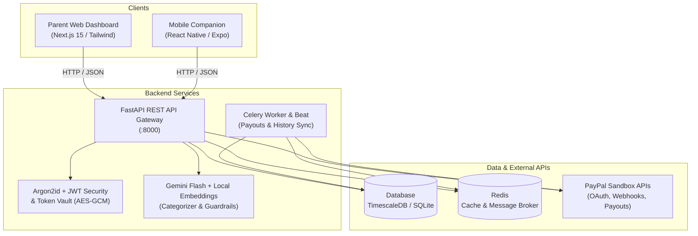

# 🪙 PennyPilot AI
### AI-Powered Family Budgeting, Smart Allowances & Real-Time Financial Guardrails

[](https://github.com/Anushka-ece/Paypal_smartshoppingassitant/actions/workflows/ci.yml)
[](https://fastapi.tiangolo.com)
[](https://nextjs.org)
[](https://python.org)
[](https://developer.paypal.com)
[](LICENSE)

**PennyPilot AI** is an intelligent family financial platform that unites parents and children to build healthy spending habits. It integrates **PayPal OAuth 2.0 & Webhooks**, a **TimescaleDB double-entry ledger**, **Google Gemini AI guardrails**, interactive **virtual envelope budgeting**, and automated **allowance disbursements**.

---

## 📑 Table of Contents

- [Key Features](#-key-features)
- [System Architecture](#-system-architecture)
- [Prerequisites](#-prerequisites)
- [Quick Start Guide](#-quick-start-guide)
  - [1. Clone and Navigate](#1-clone-and-navigate)
  - [2. Backend Setup (FastAPI)](#2-backend-setup-fastapi)
  - [3. Frontend Setup (Next.js)](#3-frontend-setup-nextjs)
  - [4. Mobile Companion (Optional)](#4-mobile-companion-optional)
- [Environment Configuration](#-environment-configuration)
- [Project Structure](#-project-structure)
- [API Documentation & Web Navigation](#-api-documentation--web-navigation)
- [Automated Testing & Verification](#-automated-testing--verification)
- [Security & Compliance](#-security--compliance)
- [License](#-license)

---

## ✨ Key Features

- **🛡️ AI Policy Guardrails & Simulator**: Define natural language family spending rules (e.g. *"Block gaming purchases over $25"*). Evaluated using high-speed semantic matching and Google Gemini Flash fallback.
- **✉️ Virtual Envelope Budgeting**: Dynamic category envelopes with automated refund reconciliation and debit/credit ledger balance conservation.
- **💳 PayPal Integration**:
  - OAuth 2.0 account linking with encrypted token storage.
  - Real-time Webhook routing engine with cryptographic HMAC-SHA256 signature verification.
  - Historical transaction ingestion via the PayPal Reporting API.
  - Idempotent Payouts v1 engine for scheduled pocket-money disbursements.
- **🔐 Enterprise-Grade Security**:
  - Argon2id password hashing with automatic legacy scrypt upgrade.
  - AES-256-GCM token encryption for financial credentials.
  - JWT authentication with token versioning for instant single-click session revocation.
  - Strict tenant isolation preventing IDOR vulnerabilities across families.
  - COPPA compliance helpers for minors under 13.
- **📱 Multi-Platform Experience**:
  - Responsive **Next.js 15 Web Dashboard** for parents.
  - **React Native / Expo Mobile App** for children and on-the-go parent approval alerts.

---

## 🏛️ System Architecture



---

## 📋 Prerequisites

Ensure you have the following installed on your machine:

- **Python**: `3.9` or `3.11+`
- **Node.js**: `v18.x` or `v20.x` (LTS recommended) & **npm** (`10+`)
- **Git**
- *(Optional)*: **Docker** & **Redis** (for background Celery workers; SQLite & synchronous fallbacks work out of the box for local development).

---

## 🚀 Quick Start Guide

### 1. Clone and Navigate

```bash
git clone https://github.com/Anushka-ece/Paypal_smartshoppingassitant.git
cd Paypal_smartshoppingassitant
```

---

### 2. Backend Setup (FastAPI)

#### On macOS / Linux:

```bash
# 1. Create and activate a Python virtual environment
python3 -m venv venv
source venv/bin/activate

# 2. Install dependencies
pip install --upgrade pip
pip install -r requirements.txt

# 3. Create the backend configuration file
cp project_ver_1/backend/.env.example project_ver_1/backend/.env

# 4. Generate distinct 32-byte security keys
JWT_SECRET=$(python3 -c "import secrets; print(secrets.token_urlsafe(32))")
ENC_KEY=$(python3 -c "import secrets; print(secrets.token_urlsafe(32))")

# Update .env with generated secrets (or edit project_ver_1/backend/.env manually)
sed -i '' "s|replace-with-a-random-secret-at-least-32-bytes|$JWT_SECRET|g" project_ver_1/backend/.env
sed -i '' "s|replace-with-a-different-random-secret-at-least-32-bytes|$ENC_KEY|g" project_ver_1/backend/.env

# 5. Initialize the database tables
PYTHONPATH=project_ver_1/backend python3 -c "
from app.database import engine, Base
import app.models
Base.metadata.create_all(bind=engine)
print('Database tables initialized successfully!')
"

# 6. Start the FastAPI backend server
PYTHONPATH=project_ver_1/backend uvicorn app.main:app --reload --host 127.0.0.1 --port 8000
```

#### On Windows (PowerShell):

```powershell
# 1. Create and activate a Python virtual environment
python -m venv venv
.\venv\Scripts\Activate.ps1

# 2. Install dependencies
python -m pip install --upgrade pip
python -m pip install -r requirements.txt

# 3. Create the backend configuration file
Copy-Item project_ver_1\backend\.env.example project_ver_1\backend\.env

# 4. Generate keys and place in project_ver_1\backend\.env:
python -c "import secrets; print(secrets.token_urlsafe(32))"

# 5. Initialize the database tables
$env:PYTHONPATH="project_ver_1\backend"
python -c "from app.database import engine, Base; import app.models; Base.metadata.create_all(bind=engine); print('Initialized!')"

# 6. Start the FastAPI backend server
python -m uvicorn app.main:app --reload --host 127.0.0.1 --port 8000
```

The backend is now live at **`http://127.0.0.1:8000`** with OpenAPI Swagger docs at **`http://127.0.0.1:8000/docs`**.

---

### 3. Frontend Setup (Next.js)

Open a new terminal window:

```bash
# Navigate to the frontend directory
cd project_ver_1/frontend

# Install dependencies
npm install

# Start the Next.js development server
npm run dev
```

The web dashboard is now live at **`http://localhost:3000`**.

---

### 4. Mobile Companion (Optional)

To run the React Native / Expo mobile app:

```bash
cd project_ver_1/mobile
npm install
npm start
```
*Press `i` for iOS Simulator, `a` for Android Emulator, or scan the QR code with the Expo Go app.*

---

## ⚙️ Environment Configuration

Backend settings are located in [`project_ver_1/backend/.env`](project_ver_1/backend/.env):

| Variable | Default (Local Dev) | Description |
| :--- | :--- | :--- |
| `DATABASE_URL` | `sqlite:///./paypal_family_budget.db` | Database connection string (SQLite for dev; PostgreSQL for production). |
| `APP_JWT_SECRET` | *(Generated random 32+ bytes)* | Secret used to sign HS256 authentication tokens. |
| `TOKEN_ENCRYPTION_KEY` | *(Generated random 32+ bytes)* | Secret key for AES-256-GCM encryption of PayPal tokens at rest. |
| `APP_ENV` | `development` | Set to `production` in live deployments (activates strict security audits). |
| `PAYPAL_CLIENT_ID` | `your_sandbox_client_id` | PayPal REST App Client ID from developer.paypal.com. |
| `PAYPAL_CLIENT_SECRET` | `your_sandbox_secret` | PayPal REST App Secret. |
| `PAYPAL_BASE_URL` | `https://api-m.sandbox.paypal.com` | PayPal API endpoint (Sandbox). |
| `PAYPAL_PAYOUTS_ENABLED` | `false` | Explicit toggle to enable live PayPal Payouts v1 disbursements. |
| `PAYPAL_ALLOW_MOCK_WEBHOOKS`| `true` (dev) / `false` (prod) | Allows local testing of webhook payloads without remote PayPal DNS. |
| `GEMINI_API_KEY` | `your_gemini_api_key` | Google AI Studio key for Gemini Flash classification & policy checks. |
| `REDIS_URL` | `redis://localhost:6379/0` | Redis instance for Celery queues and webhook deduplication. |

---

## 📁 Project Structure

```text
Paypal_smartshoppingassitant/
├── project_ver_1/
│   ├── backend/
│   │   ├── app/
│   │   │   ├── api/             # API Routers (auth, allowances, budgets, family, guardrails, webhooks, etc.)
│   │   │   ├── middleware/      # Security Headers (HSTS, CSP, nosniff) & CORS configuration
│   │   │   ├── models/          # 11 Modular SQLAlchemy models (Double-entry ledger, User, Account, etc.)
│   │   │   ├── security/        # Argon2id hashing, AES-256-GCM Token Vault, JWT, COPPA VPC
│   │   │   ├── services/        # PayPalService, GeminiService, EmbeddingService, ReputationService
│   │   │   └── workers/         # Celery tasks & Celery Beat payout scheduler
│   │   ├── migrations/          # Alembic schema versioning
│   │   └── tests/               # 104 Unit & Integration tests (100% passing)
│   ├── frontend/                # Next.js 15 App Router Web Dashboard
│   │   ├── app/                 # Pages (/dashboard, /login, /budgets, /guardrails, /requests, etc.)
│   │   └── hooks/               # Session & Authentication React hooks
│   └── mobile/                  # React Native / Expo Companion App
│       └── src/                 # Screens, navigation (AppNavigator.js), & push alerts
├── requirements.txt             # Unified Python dependencies
└── pytest.ini                   # Pytest test suite configuration
```

---

## 🌐 API Documentation & Web Navigation

### Frontend Web Routes

| URL Path | Purpose |
| :--- | :--- |
| **`/login`** | Secure parent sign-in with Argon2id verification and JWT issuance. |
| **`/register`** | Create a new family profile and initial parent administrator account. |
| **`/dashboard`** | Live family overview: aggregate spend, active guardrails, and child envelopes. |
| **`/budgets`** | Virtual category envelopes, spending bars, and allowance allocations. |
| **`/guardrails/simulator`** | Interactive natural-language rule tester with instant Gemini evaluation. |
| **`/requests`** | Child store requests and parent single-click approval/capture flow. |
| **`/transactions`** | Filterable transaction audit log with refund and dispute reconciliation. |
| **`/connect`** | Connect and link parent PayPal accounts via OAuth 2.0. |

### Backend API Interactive Docs

Navigate to **`http://127.0.0.1:8000/docs`** to test all endpoints via Swagger UI:
- `POST /api/auth/register` & `POST /api/auth/login`
- `GET /api/auth/paypal/authorize` & `GET /api/auth/paypal/callback`
- `POST /api/guardrails/policies` & `POST /api/guardrails/simulate`
- `POST /api/webhooks/paypal`
- `GET /api/transactions` & `POST /api/transactions/{id}/reclassify`
- `POST /api/allowances/disburse`

---

## 🧪 Automated Testing & Verification

The project includes **104 automated tests** with 100% pass rate:

```bash
# Run the entire backend test suite
pytest project_ver_1/backend/tests/ -v

# Run type check and Next.js frontend build validation
cd project_ver_1/frontend
npm run typecheck
npm run build
```

---

## 🔒 Security & Compliance

- **FTC COPPA Compliance**: Verifiable Parental Consent (VPC) protocol verifies parent identity and active PayPal account connection before enabling minor accounts under 13.
- **Fail-Closed Configuration**: In production (`APP_ENV=production`), the application halts startup if placeholder keys, weak secrets, or disabled webhooks are detected.
- **Anti-IDOR Multi-Tenancy**: All database queries strictly bind to the authenticated user's `family_id` extracted from the cryptographically verified JWT.
- **Audited Financial Ledger**: Transactions cannot be hard-deleted; refunds and disputes are appended as balancing credit entries in the double-entry ledger.

---

## 📄 License

This project is licensed under the MIT License — see the [LICENSE](LICENSE) file for details.
